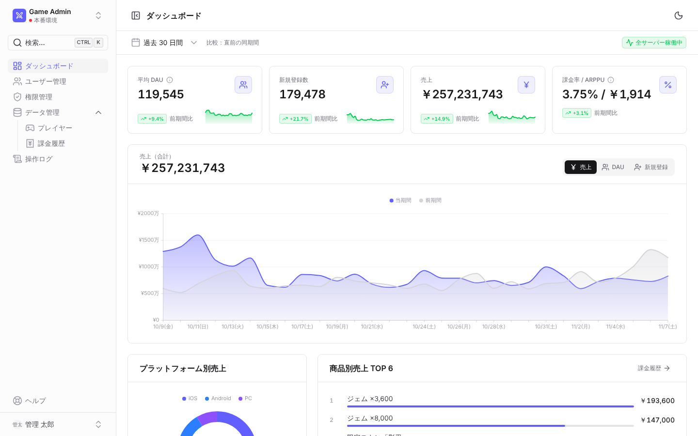
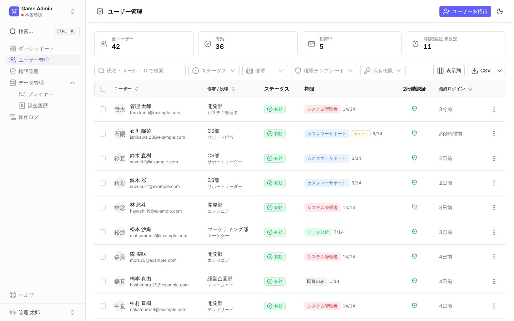
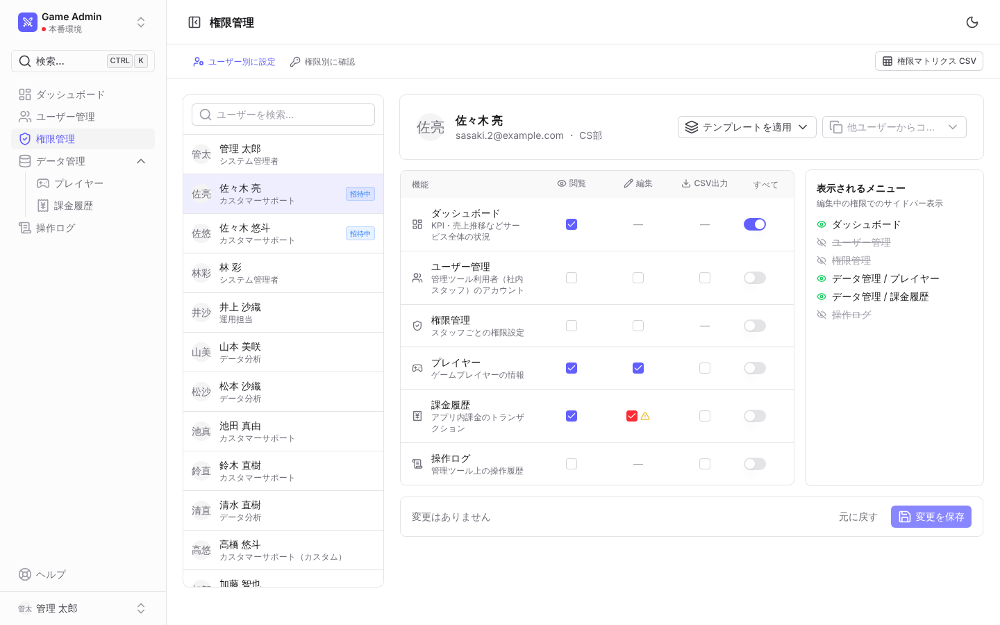
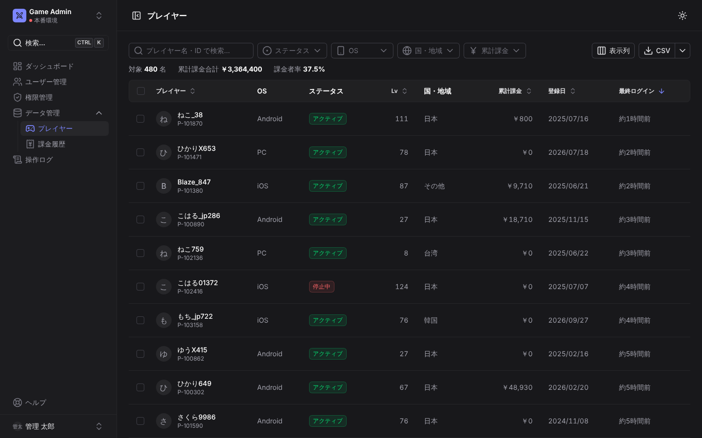

# Game Admin Console（モック）

ゲーム系サービスの社内向け管理ツールの UI/UX 検討用モックです。
Nuxt 4 + Nuxt UI 4 で、[Nuxt UI 公式 Dashboard テンプレート](https://github.com/nuxt-ui-templates/dashboard) の構成（`UDashboardGroup` / `UDashboardSidebar` / `UDashboardPanel`）に合わせて作っています。

- データはブラウザ内で生成した仮データです。API・DB・認証は実装していません
- 操作（権限変更・停止・返金など）はメモリ上で反映され、リロードすると初期状態に戻ります
- **ユーザーメニュー（左下）→「ログインユーザー切替（モック）」** で権限ごとのメニュー・ボタンの出し分けを確認できます

## 起動

```bash
cd admin-console
npm install
npm run dev        # http://localhost:3000
```

| コマンド | 内容 |
| --- | --- |
| `npm run dev` | 開発サーバー |
| `npm run typecheck` | 型チェック（vue-tsc） |
| `npm run generate` | 静的ファイルとして出力（`.output/public`。社内向けにそのまま配置可能） |

## 画面

| パス | 画面 | 必要な権限 | 主な機能 |
| --- | --- | --- | --- |
| `/` | ダッシュボード | `dashboard.view` | KPI カード、売上/DAU/新規の推移（前期間比較）、OS 別売上、商品別売上、イベント一覧、更新履歴 |
| `/users` | ユーザー管理 | `users.view` | 一覧・検索・絞り込み（ステータス/部署/テンプレート/保有権限）、招待、停止・再開（一括可）、CSV |
| `/users/:id` | ユーザー詳細 | `users.view` | プロフィール、権限マトリクス（閲覧）、操作履歴 |
| `/permissions` | 権限管理 | `permissions.view`（変更は `permissions.edit`） | ユーザー別の個別権限編集、差分表示、テンプレート適用・他ユーザーからコピー、メニュー表示プレビュー、権限別の付与状況、権限マトリクス CSV |
| `/data/players` | データ管理：プレイヤー | `players.view` | 一覧・検索・フィルター・ソート、詳細スライドオーバー、アカウント停止、CSV |
| `/data/purchases` | データ管理：課金履歴 | `purchases.view` | 期間/ステータス/OS/商品フィルター、絞り込み結果の集計、返金、CSV |
| `/audit-logs` | 操作ログ | `auditLogs.view` | 権限変更・CSV 出力などの操作履歴、CSV |

## ディレクトリ構成

```
app/
├─ components/
│  ├─ app/                    # 画面をまたいで使う共通コンポーネント
│  │  ├─ AppPage.vue          #   画面の共通枠（ヘッダー・ツールバー）
│  │  ├─ AppDataTable.vue     #   検索/フィルター/ソート/ページング/選択/CSV 付きテーブル
│  │  ├─ AppKpiCard.vue       #   KPI カード（前期間比・ミニグラフ）
│  │  ├─ AppConfirmDialog.vue #   確認ダイアログ（useConfirm から呼ぶ）
│  │  ├─ AppCan.vue           #   権限による表示/無効化の切替
│  │  ├─ AppDescriptionList.vue
│  │  ├─ AppUserMenu.vue / AppBrand.vue / AppHeaderTools.vue
│  ├─ permissions/            # PermissionMatrix（閲覧/編集兼用）, PermissionSummary
│  └─ users/                  # UserInviteModal
├─ composables/
│  ├─ useMockDb.ts            # モックデータの保持（本番では API クライアントに置換）
│  ├─ useSession.ts           # ログイン中ユーザー（モック）
│  ├─ usePermission.ts        # can('users.edit') などの権限チェック
│  ├─ useCsvExport.ts         # CSV 出力の共通処理（権限チェック・ログ記録・通知込み）
│  ├─ useConfirm.ts           # await confirm({...}) 形式の確認ダイアログ
│  ├─ useTableColumns.ts      # ソート可能ヘッダー・ステータスバッジ等の列ヘルパー
│  ├─ useAuditLog.ts / useUserActions.ts
├─ middleware/permission.global.ts  # 画面単位の権限ガード
├─ utils/
│  ├─ permissions.ts          # 権限カタログ・テンプレート定義
│  ├─ navigation.ts           # サイドバー/コマンドパレット共通のメニュー定義
│  ├─ csv.ts                  # CSV 生成（UI 非依存）
│  ├─ labels.ts / format.ts   # ステータス表示・日付/金額フォーマット
│  └─ mock/generate.ts        # シード付き乱数による仮データ生成
├─ layouts/default.vue        # サイドバー + コマンドパレット
└─ pages/
```

## 共通仕様

### CSV ダウンロード

一覧画面は `AppDataTable` に `csv` を渡すだけで CSV ボタンが付きます。画面ごとの実装は列定義のみです。

```vue
<AppDataTable
  :data="rows"
  :columns="columns"
  :filters="filters"
  :search-keys="['name', 'id']"
  :csv="{ filename: 'players', columns: csvColumns, permission: 'players.export', label: 'プレイヤー一覧' }"
/>
```

- **現在の検索・フィルター・ソート状態を反映**して出力（ドロップダウンから「選択行のみ」も可）
- Excel で文字化けしないよう UTF-8 BOM 付き、数式インジェクション対策済み
- ファイル名に日時を付与（例：`players_20261107-1530.csv`）
- 出力権限（`*.export`）が無い場合はボタンを無効化し、理由をツールチップ表示
- 出力すると操作ログに「件数・絞り込み条件」を記録
- 絞り込み条件は `v-model:query`（`{ q, filters }`）として外に出せるため、本番で件数が多い場合は
  この状態を API のクエリに変換し、サーバー側生成に切り替えられる構造

一覧以外のデータ（例：権限マトリクス）は `useCsvExport().exportCsv(rows, options)` を直接呼びます。

### 権限

- 権限キーは `リソース.操作`（`users.view` / `users.edit` / `players.export` …）。定義は `utils/permissions.ts` に集約
- **個別権限方式**：ユーザーが権限キーを直接保持。テンプレートは「一括で入れるためのプリセット」扱いで、変更されると「カスタム」表示
- 編集・CSV 出力には閲覧が必要（自動で付与・解除）。自分自身の権限管理権限は外せない
- 権限チェックは 3 段階：メニュー（`navigation.ts` の `permission`）、画面（`definePageMeta({ permission })` + グローバルミドルウェア）、ボタン（`<AppCan>` / `can()`）
- 高リスク権限（`permissions.edit` など）の付与時は、確認ダイアログで文字入力を求める

> モックの権限チェックは表示制御のみです。本番では必ず API 側で認可を行ってください。

### 画面を追加するとき

1. `pages/` にページを作り、`definePageMeta({ permission: 'xxx.view' })` を指定
2. 中身を `<AppPage>` で包み、一覧なら `<AppDataTable>` を使う
3. `utils/navigation.ts` にメニューを 1 行追加
4. 新しいリソースなら `utils/permissions.ts` の `PERMISSION_RESOURCES` に追加（権限管理画面のマトリクスに自動で表示されます）

## 仮定（未確定の仕様）

| 項目 | 今回の仮定 |
| --- | --- |
| 「ユーザー管理」の対象 | 管理ツールを使う**社内スタッフ**。ゲームのプレイヤーは「データ管理 > プレイヤー」で扱う |
| 権限方式 | 個別権限を中心に実装。グループ方式は「テンプレート」で代替表示しており、採用時は `PERMISSION_TEMPLATES` をグループ定義に昇格させる想定 |
| 権限の粒度 | 画面（リソース）× 閲覧/編集/CSV 出力。項目単位・タイトル単位の権限は未対応 |
| データ件数 | プレイヤー 480 件・課金 2,000 件程度をクライアント側で検索・ソート。本番の大量データはサーバー側ページング想定 |
| 環境切替（本番/ステージング） | サイドバー上部の切替は見た目のみ |
| レンダリング | 社内ツールのため SPA（`ssr: false`）。静的ファイルとして配置可能 |
| ダッシュボード指標 | DAU・新規登録・売上・課金率/ARPPU を仮置き。指標の定義は要確認 |

## スクリーンショット

| ダッシュボード | ユーザー管理 |
| --- | --- |
|  |  |
| **権限管理** | **プレイヤー（ダークモード）** |
|  |  |
