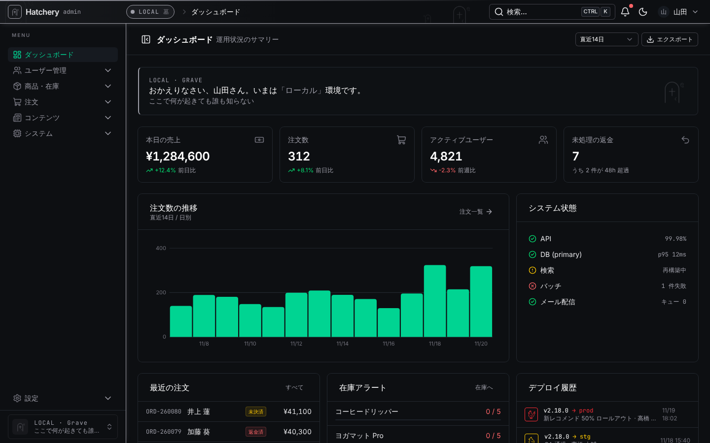
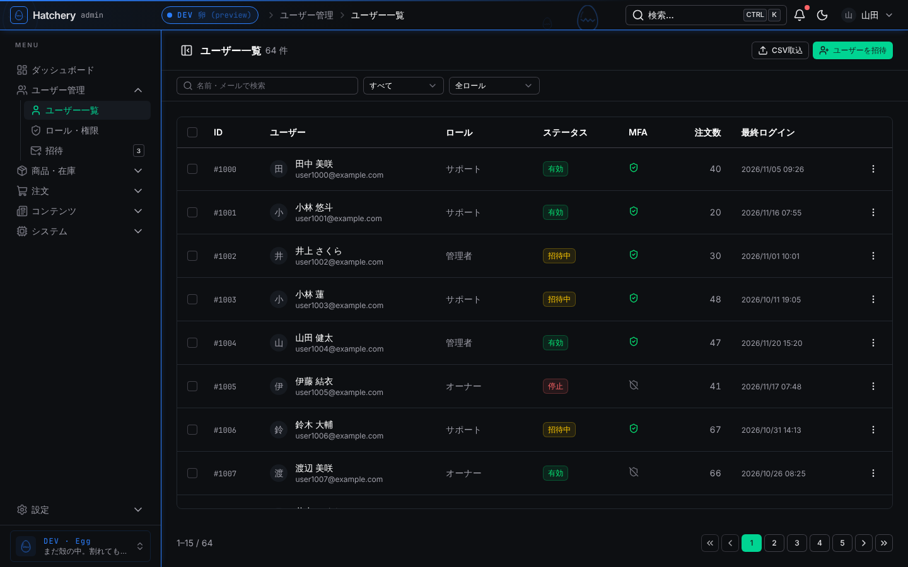
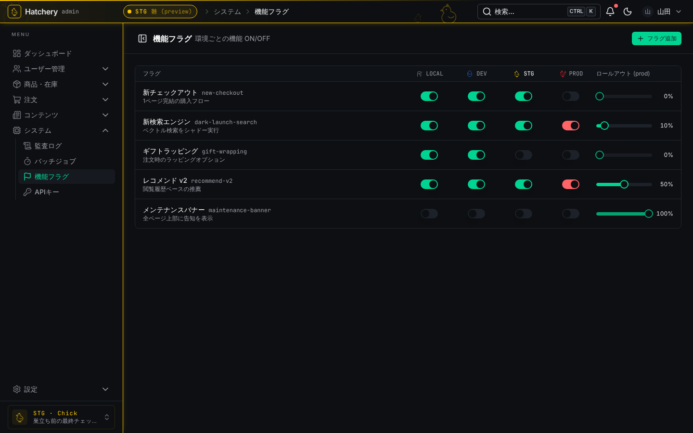
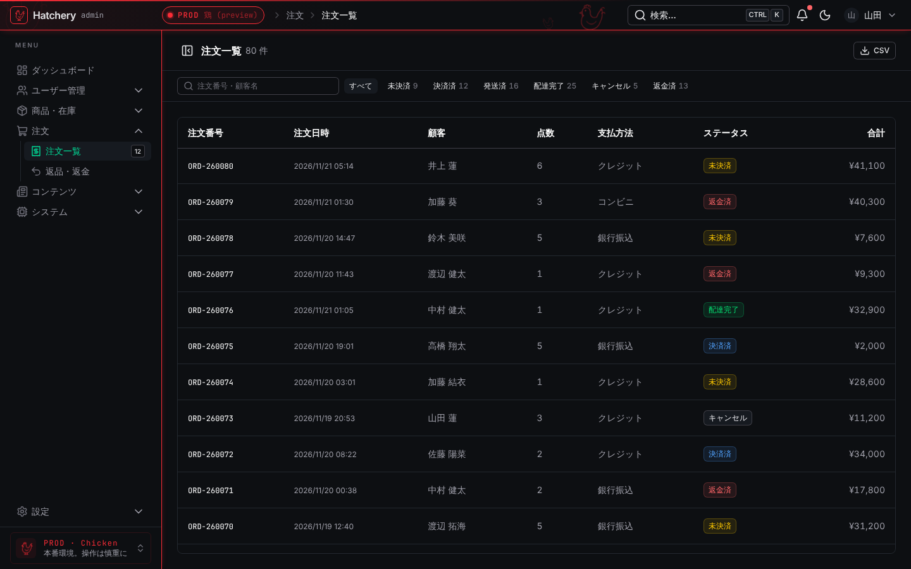

# Hatchery Admin

Nuxt 4 + Nuxt UI v4 で作った PC 向け管理ツールのモック。

## 環境カラー

| 環境 | 色 | マスコット |
|---|---|---|
| local | グレー | 墓 |
| dev | 青 | 卵 |
| stg | 黄 | 雛 |
| prod | 赤 | 鶏 |

環境色はタイトルバーの下線とサイドバーの右線だけに使っています（本文の背景は全環境共通）。
マスコットはタイトルバーに薄く表示されます。

## 起動

```bash
npm install
npm run dev          # local
npm run dev:stg      # NUXT_PUBLIC_APP_ENV=stg
```

環境は `NUXT_PUBLIC_APP_ENV`（local / dev / stg / prod）で切り替えます。
サイドバー下部のスイッチャーで、見た目だけ他の環境をプレビューすることもできます（cookie に保存されます）。

prod では、破壊的な操作（利用停止・返金承認・本番フラグ変更）を実行するときに確認ワードの入力が必要です。

## 画面

- ダッシュボード
- ユーザー管理: 一覧 / 詳細 / ロール・権限 / 招待
- 商品・在庫: 商品一覧 / カテゴリ（ツリー） / 在庫
- 注文: 注文一覧（詳細スライドオーバー） / 返品・返金
- コンテンツ: お知らせ / バナー
- システム: 監査ログ / バッチジョブ / 機能フラグ / APIキー
- 設定: 一般 / 通知 / セキュリティ

データはすべて `app/utils/mock.ts` のモックです。

## スクリーンショット

| local | dev |
|---|---|
|  |  |
| **stg** | **prod** |
|  |  |
